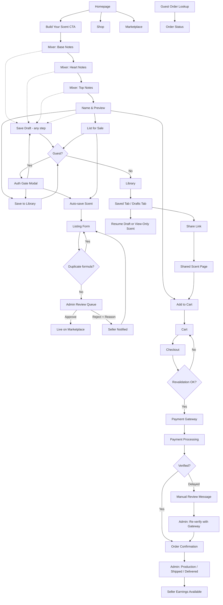

# Core Flows — Build a Scent

## Navigation Structure

The global navigation bar contains: **Logo · Build a Scent · Shop · Marketplace · My Library** (logged-in only) **· Cart** (icon with item count) **· Notifications** (bell with unread count, logged-in only) **· Account** (avatar/icon top-right). On mobile, collapses to a hamburger menu (cart icon stays visible). Guests see "Sign In" in place of Account. The footer contains a **Look Up Order** link (Flow 10).

## Flow 1 — Landing & Entry

**Trigger:** User visits the homepage.

1. User lands on a full-screen marketing/hero section with brand visuals (dark, moody, luxurious aesthetic).
2. A prominent **"Build Your Scent"** CTA button is displayed front and centre.
3. Secondary CTAs: **"Shop"** (pre-made products) and **"Explore Marketplace"** (community scents).
4. User clicks "Build Your Scent" → navigates to the Mixer page (`/build`).

```wireframe

<html>
<head>
<style>
  * { box-sizing: border-box; margin: 0; padding: 0; font-family: Georgia, serif; }
  body { background: #0a0a0a; color: #e8d5a3; min-height: 100vh; }
  nav { display: flex; justify-content: space-between; align-items: center; padding: 18px 40px; border-bottom: 1px solid #2a2a2a; }
  .nav-logo { font-size: 1.2rem; letter-spacing: 3px; color: #c9a84c; }
  .nav-links { display: flex; gap: 32px; font-size: 0.8rem; letter-spacing: 2px; color: #999; }
  .nav-links span { cursor: pointer; }
  .nav-links span:hover { color: #c9a84c; }
  .hero { display: flex; flex-direction: column; align-items: center; justify-content: center; min-height: 85vh; text-align: center; padding: 40px; }
  .hero-eyebrow { font-size: 0.7rem; letter-spacing: 4px; color: #c9a84c; margin-bottom: 20px; }
  .hero-title { font-size: 3rem; color: #f0e6cc; margin-bottom: 16px; line-height: 1.2; }
  .hero-sub { font-size: 0.95rem; color: #888; max-width: 480px; margin-bottom: 40px; line-height: 1.7; }
  .cta-primary { background: #c9a84c; color: #0a0a0a; padding: 16px 40px; font-size: 0.85rem; letter-spacing: 3px; border: none; cursor: pointer; margin-bottom: 16px; }
  .cta-secondary { display: flex; gap: 24px; }
  .cta-ghost { border: 1px solid #444; color: #aaa; padding: 12px 28px; font-size: 0.75rem; letter-spacing: 2px; cursor: pointer; background: transparent; }
</style>
</head>
<body>
  <nav>
    <div class="nav-logo">BUILD A SCENT</div>
    <div class="nav-links">
      <span>BUILD A SCENT</span>
      <span>SHOP</span>
      <span>MARKETPLACE</span>
      <span>SIGN IN</span>
    </div>
  </nav>
  <div class="hero">
    <div class="hero-eyebrow">CRAFT YOUR SIGNATURE FRAGRANCE</div>
    <h1 class="hero-title">Your Scent.<br/>Your Story.</h1>
    <p class="hero-sub">Blend rare ingredients into a fragrance that is uniquely yours. Order it, wear it, or sell it to the world.</p>
    <button class="cta-primary" data-element-id="hero-cta-build">BUILD YOUR SCENT</button>
    <div class="cta-secondary">
      <button class="cta-ghost" data-element-id="hero-cta-shop">SHOP COLLECTION</button>
      <button class="cta-ghost" data-element-id="hero-cta-marketplace">EXPLORE MARKETPLACE</button>
    </div>
  </div>
</body>
</html>
```

## Flow 2 — Scent Mixer Journey

**Trigger:** User clicks "Build Your Scent" from homepage or nav.

The mixer is a 4-step wizard with a persistent animated bottle visual on the right that fills as ingredients are added.

- A **"Save Draft"** button sits in the wizard header on every step once at least 1 ingredient has been chosen. It saves the partial blend and the current step (auth gate for guests, Flow 3), so **Resume** later returns the user to exactly that step.
- Ingredients can be dragged into the drop zone **or** selected by click/keyboard (accessibility).
- Only active ingredients are shown.

### Step 1 — Base Notes

1. User sees a grid of base note ingredient cards (e.g. Sandalwood, Musk, Amber, Cedarwood). Each card shows a colour swatch, name, and scent family tag.
2. User drags 1–3 ingredient cards into the bottle drop zone. The bottle animates — coloured liquid pours in from the bottom.
3. A progress indicator shows "Step 1 of 4 — Base Notes". A "Next" button activates once at least 1 ingredient is selected.
4. User clicks **Next** → transitions to Step 2 with an animated slide.

### Step 2 — Middle / Heart Notes

1. Same mechanic — user drags 1–3 heart note ingredients (e.g. Rose, Jasmine, Iris, Ylang Ylang).
2. Bottle fills further; the new colour layer blends visually above the base layer.
3. User clicks **Next**.

### Step 3 — Top Notes

1. Same mechanic — user drags 1–3 top note ingredients (e.g. Bergamot, Lemon, Mint, Pepper).
2. Bottle is now visually full with all three colour layers visible.
3. User clicks **Next**.

### Step 4 — Name & Preview

1. User sees their completed bottle with all three note layers animated.
2. A text field prompts: **"Give your scent a name"**.
3. Below the bottle: a breakdown card showing all selected ingredients grouped by tier.
4. User selects **bottle size** (10ml / 30ml / 50ml / 100ml) and **format** (Spray / Roll-on / Oil); the price updates dynamically. Price = bottle base price + ingredient cost. Ingredient cost scales with the bottle's volume and the format's concentration, with the concentrate split across tiers by fixed shares (see Tech Plan, Decision 7).
5. Three action buttons (plus **Save Draft** in the header):
  - **"Add to Cart"** → adds the blend to the cart and proceeds to the checkout flow.
  - **"Save to Library"** → saves the scent as a finished blend (auth gate for guests), then shows a success toast.
  - **"List for Sale"** → requires auth if needed, saves the scent first, then opens the marketplace listing flow (see Flow 5).

```wireframe

<html>
<head>
<style>
  * { box-sizing: border-box; margin: 0; padding: 0; font-family: Georgia, serif; }
  body { background: #0a0a0a; color: #e8d5a3; min-height: 100vh; }
  nav { display: flex; justify-content: space-between; align-items: center; padding: 14px 32px; border-bottom: 1px solid #1e1e1e; }
  .nav-logo { font-size: 1rem; letter-spacing: 3px; color: #c9a84c; }
  .nav-links { display: flex; gap: 24px; font-size: 0.75rem; letter-spacing: 2px; color: #666; }
  .mixer-layout { display: grid; grid-template-columns: 1fr 320px; gap: 0; min-height: calc(100vh - 53px); }
  .mixer-left { padding: 32px 40px; border-right: 1px solid #1e1e1e; }
  .step-indicator { display: flex; gap: 8px; margin-bottom: 28px; }
  .step { width: 32px; height: 3px; background: #222; }
  .step.active { background: #c9a84c; }
  .step.done { background: #5a4a2a; }
  .mixer-title { font-size: 0.7rem; letter-spacing: 3px; color: #c9a84c; margin-bottom: 8px; }
  .mixer-heading { font-size: 1.6rem; color: #f0e6cc; margin-bottom: 6px; }
  .mixer-sub { font-size: 0.8rem; color: #666; margin-bottom: 28px; }
  .ingredient-grid { display: grid; grid-template-columns: repeat(3, 1fr); gap: 12px; margin-bottom: 32px; }
  .ingredient-card { border: 1px solid #2a2a2a; padding: 14px 12px; cursor: grab; text-align: center; }
  .ingredient-card.selected { border-color: #c9a84c; }
  .swatch { width: 36px; height: 36px; border-radius: 50%; margin: 0 auto 8px; }
  .ing-name { font-size: 0.75rem; color: #ccc; letter-spacing: 1px; }
  .ing-tag { font-size: 0.65rem; color: #666; margin-top: 3px; }
  .drop-zone { border: 1px dashed #333; padding: 16px; text-align: center; color: #555; font-size: 0.75rem; letter-spacing: 2px; margin-bottom: 24px; }
  .btn-next { background: #c9a84c; color: #0a0a0a; padding: 14px 36px; font-size: 0.8rem; letter-spacing: 2px; border: none; cursor: pointer; }
  .mixer-right { padding: 32px 24px; display: flex; flex-direction: column; align-items: center; }
  .bottle-visual { width: 100px; height: 200px; border: 2px solid #333; border-radius: 8px 8px 4px 4px; margin: 24px auto; position: relative; overflow: hidden; background: #111; }
  .bottle-layer { position: absolute; bottom: 0; width: 100%; }
  .layer-base { height: 40%; background: linear-gradient(180deg, #6b3a2a, #8b4513); opacity: 0.8; }
  .bottle-label { font-size: 0.65rem; letter-spacing: 2px; color: #666; text-align: center; margin-top: 8px; }
  .notes-summary { width: 100%; margin-top: 16px; }
  .note-row { display: flex; justify-content: space-between; padding: 8px 0; border-bottom: 1px solid #1a1a1a; font-size: 0.72rem; color: #888; }
  .note-label { color: #c9a84c; }
</style>
</head>
<body>
  <nav>
    <div class="nav-logo">BUILD A SCENT</div>
    <div class="nav-links"><span>BUILD A SCENT</span><span>SHOP</span><span>MARKETPLACE</span><span>MY LIBRARY</span></div>
  </nav>
  <div class="mixer-layout">
    <div class="mixer-left">
      <div class="step-indicator">
        <div class="step done"></div>
        <div class="step active"></div>
        <div class="step"></div>
        <div class="step"></div>
      </div>
      <div class="mixer-title">STEP 2 OF 4</div>
      <h2 class="mixer-heading">Heart Notes</h2>
      <p class="mixer-sub">Choose 1–3 ingredients that form the soul of your scent.</p>
      <div class="ingredient-grid">
        <div class="ingredient-card selected" data-element-id="ing-rose">
          <div class="swatch" style="background:#c06080;"></div>
          <div class="ing-name">ROSE</div><div class="ing-tag">Floral</div>
        </div>
        <div class="ingredient-card" data-element-id="ing-jasmine">
          <div class="swatch" style="background:#e8d870;"></div>
          <div class="ing-name">JASMINE</div><div class="ing-tag">Floral</div>
        </div>
        <div class="ingredient-card" data-element-id="ing-iris">
          <div class="swatch" style="background:#7b68c8;"></div>
          <div class="ing-name">IRIS</div><div class="ing-tag">Powdery</div>
        </div>
        <div class="ingredient-card" data-element-id="ing-ylang">
          <div class="swatch" style="background:#d4a843;"></div>
          <div class="ing-name">YLANG YLANG</div><div class="ing-tag">Exotic</div>
        </div>
        <div class="ingredient-card" data-element-id="ing-geranium">
          <div class="swatch" style="background:#7ab648;"></div>
          <div class="ing-name">GERANIUM</div><div class="ing-tag">Green</div>
        </div>
        <div class="ingredient-card" data-element-id="ing-peony">
          <div class="swatch" style="background:#e8a0b0;"></div>
          <div class="ing-name">PEONY</div><div class="ing-tag">Floral</div>
        </div>
      </div>
      <div class="drop-zone" data-element-id="drop-zone">DRAG INGREDIENTS HERE · 1 SELECTED · MAX 3</div>
      <button class="btn-next" data-element-id="btn-next">NEXT →</button>
    </div>
    <div class="mixer-right">
      <div class="bottle-label">YOUR BLEND</div>
      <div class="bottle-visual">
        <div class="bottle-layer layer-base"></div>
      </div>
      <div class="bottle-label">FILLING...</div>
      <div class="notes-summary">
        <div class="note-row"><span class="note-label">BASE</span><span>Sandalwood, Musk</span></div>
        <div class="note-row"><span class="note-label">HEART</span><span>Rose ···</span></div>
        <div class="note-row"><span class="note-label">TOP</span><span>—</span></div>
      </div>
    </div>
  </div>
</body>
</html>
```

## Flow 3 — Guest Auth Gate (Save to Library)

**Trigger:** Guest user clicks **"Save Draft"**, **"Save to Library"**, **"List for Sale"**, or another save/listing action in the mixer.

1. A modal overlays the current screen with the message: **"Save your scent — create a free account or sign in."**
2. Options: **Sign Up** (email/password) or **Sign In** (existing account). **Continue with Google** is shown below.
3. Before auth starts, the in-progress blend and the pending action are stored in the browser session, so they survive the Google redirect.
4. On successful auth, the modal closes and the requested action completes automatically. If the action was **List for Sale**, the scent is first saved and then the listing flow opens.
5. User is returned to exactly where they were (mixer step, listing flow, library, etc.).
6. Listing for sale additionally requires a **verified email**. If the email is unverified, the listing form shows a "Verify your email to list" prompt with a resend link; the saved scent is kept.

## Flow 4 — Checkout (Custom Scent or Standard Product)

**Trigger:** User clicks "Add to Cart" from the mixer preview or a product page.

1. Cart icon in nav updates with item count. User can continue shopping or click cart to review.
2. **Cart page:** Shows item(s) with name, size/format (for custom), quantity, and price in NGN (a USD view is available as display-only). Edit or remove items. Marketplace items show their note profile, not the formula.
3. User clicks **"Proceed to Checkout"**.
4. **Checkout page:**
  - Guest: enters name, email, phone, and delivery address (street, city, Nigerian state).
  - Logged-in: details pre-filled from profile; can edit.
  - Choosing a state shows the **shipping fee** and an **estimated delivery window** (production lead time + the zone's ETA). States outside every active shipping zone show "We don't deliver here yet" and block checkout.
  - Order summary on the right: subtotal, shipping, total.
5. **Payment selection:** Two options displayed — **Paystack** and **Flutterwave** (radio buttons with logos). User selects one.
6. User clicks **"Pay Now"**.
7. Before payment starts, the platform revalidates cart prices, ingredient/bottle availability, listing availability, stock, and the shipping fee. If anything has changed, checkout is blocked and the user is returned to cart review with the updated state and a short explanation per affected item (e.g. "Price updated", "No longer available").
8. If revalidation passes, the user is redirected to the selected gateway's payment page/modal.
9. After payment, user is redirected to a **Payment Processing** page while the platform verifies the transaction with the gateway (webhook, or a direct server-side check with the gateway).
10. If payment fails, the page says so and offers **"Try again"**, which returns to checkout with the cart intact.
11. If verification takes longer than about 90 seconds, the page stops spinning and explains that the payment is under manual review. The user is told they will be emailed once the team confirms the payment, and is shown their order number for lookup.
12. Once verification succeeds, the cart is cleared and the user is taken to the **Order Confirmation page**.
13. **Confirmation page:** Animated visual of the custom bottle (or product image) with scent name, notes breakdown (note profile only for marketplace items), order number, and estimated delivery window. Email confirmation is sent automatically and includes a **Look Up Order** link. Guest users can later look up the order using **order number + email**.

```wireframe

<html>
<head>
<style>
  * { box-sizing: border-box; margin: 0; padding: 0; font-family: Georgia, serif; }
  body { background: #0a0a0a; color: #e8d5a3; }
  nav { display: flex; justify-content: space-between; align-items: center; padding: 14px 32px; border-bottom: 1px solid #1e1e1e; }
  .nav-logo { font-size: 1rem; letter-spacing: 3px; color: #c9a84c; }
  .checkout-layout { display: grid; grid-template-columns: 1fr 360px; gap: 0; min-height: calc(100vh - 53px); }
  .checkout-left { padding: 40px; border-right: 1px solid #1e1e1e; }
  .section-title { font-size: 0.65rem; letter-spacing: 3px; color: #c9a84c; margin-bottom: 16px; }
  .form-group { margin-bottom: 16px; }
  label { display: block; font-size: 0.7rem; color: #888; letter-spacing: 1px; margin-bottom: 6px; }
  input { width: 100%; background: #111; border: 1px solid #2a2a2a; color: #e8d5a3; padding: 10px 12px; font-size: 0.85rem; }
  .form-row { display: grid; grid-template-columns: 1fr 1fr; gap: 12px; }
  .payment-section { margin-top: 32px; }
  .payment-option { display: flex; align-items: center; gap: 12px; border: 1px solid #2a2a2a; padding: 14px 16px; margin-bottom: 10px; cursor: pointer; }
  .payment-option.selected { border-color: #c9a84c; }
  .payment-radio { width: 14px; height: 14px; border: 1px solid #c9a84c; border-radius: 50%; }
  .payment-radio.filled { background: #c9a84c; }
  .payment-name { font-size: 0.8rem; color: #ccc; letter-spacing: 1px; }
  .pay-btn { width: 100%; background: #c9a84c; color: #0a0a0a; padding: 16px; font-size: 0.85rem; letter-spacing: 3px; border: none; cursor: pointer; margin-top: 24px; }
  .checkout-right { padding: 40px 32px; background: #080808; }
  .order-item { display: flex; justify-content: space-between; padding: 14px 0; border-bottom: 1px solid #1a1a1a; }
  .item-name { font-size: 0.85rem; color: #ccc; }
  .item-detail { font-size: 0.7rem; color: #666; margin-top: 3px; }
  .item-price { font-size: 0.85rem; color: #c9a84c; }
  .total-row { display: flex; justify-content: space-between; padding: 20px 0 0; }
  .total-label { font-size: 0.75rem; letter-spacing: 2px; color: #888; }
  .total-amount { font-size: 1.1rem; color: #c9a84c; }
  .currency-toggle { font-size: 0.65rem; color: #555; letter-spacing: 2px; margin-top: 8px; cursor: pointer; }
</style>
</head>
<body>
  <nav>
    <div class="nav-logo">BUILD A SCENT</div>
    <div style="font-size:0.75rem;letter-spacing:2px;color:#666;">SECURE CHECKOUT</div>
  </nav>
  <div class="checkout-layout">
    <div class="checkout-left">
      <div class="section-title">DELIVERY DETAILS</div>
      <div class="form-group"><label>FULL NAME</label><input value="Adaeze Okonkwo" /></div>
      <div class="form-group"><label>EMAIL</label><input value="adaeze@email.com" /></div>
      <div class="form-group"><label>PHONE</label><input value="+234 803 000 0000" /></div>
      <div class="form-group"><label>DELIVERY ADDRESS</label><input value="14 Victoria Island, Lagos" /></div>
      <div class="form-row">
        <div class="form-group"><label>CITY</label><input value="Lagos" /></div>
        <div class="form-group"><label>STATE</label><input value="Lagos State" /></div>
      </div>
      <div class="payment-section">
        <div class="section-title">SELECT PAYMENT METHOD</div>
        <div class="payment-option selected" data-element-id="pay-paystack">
          <div class="payment-radio filled"></div>
          <div class="payment-name">PAYSTACK</div>
        </div>
        <div class="payment-option" data-element-id="pay-flutterwave">
          <div class="payment-radio"></div>
          <div class="payment-name">FLUTTERWAVE</div>
        </div>
        <button class="pay-btn" data-element-id="btn-pay">PAY ₦27,500</button>
      </div>
    </div>
    <div class="checkout-right">
      <div class="section-title">ORDER SUMMARY</div>
      <div class="order-item">
        <div><div class="item-name">Midnight Bloom</div><div class="item-detail">Custom Scent · 50ml · Spray</div></div>
        <div class="item-price">₦24,500</div>
      </div>
      <div class="order-item">
        <div><div class="item-name">Shipping</div><div class="item-detail">Lagos zone · arrives in 5–7 days</div></div>
        <div class="item-price">₦3,000</div>
      </div>
      <div class="total-row">
        <div class="total-label">TOTAL</div>
        <div class="total-amount">₦27,500</div>
      </div>
      <div class="currency-toggle" data-element-id="currency-toggle">VIEW IN USD →</div>
    </div>
  </div>
</body>
</html>
```

## Flow 5 — Marketplace Listing

**Trigger:** User clicks "List for Sale" from the mixer post-build screen OR from a saved scent in their Scent Library.

1. If the user starts from the mixer, the platform requires auth if needed, saves the scent to the library first, then opens the listing form. A verified email is required (Flow 3, step 6).
2. A listing form slides in (or navigates to `/marketplace/list`):
  - Scent name (pre-filled from saved name).
  - Description field (optional, max 200 chars).
  - **Creator markup** input: the amount the creator adds on top of the blend's price (minimum set by admin, e.g. ₦1,000).
  - **Live price breakdown:** blend price (what the platform charges to make it) · your markup · **buyer pays** · "At the current platform rate (20%), you would earn ₦X per sale." Final commission is calculated at sale time; if the admin changes ingredient prices, the buyer price changes but the creator's markup does not.
  - **Featured notes:** choose up to 3 of the blend's ingredients to reveal to buyers. Buyers see only the scent families of each tier plus these featured notes; **the full formula stays private**.
  - Bottle size and format inherited from the saved blend (shown as read-only in v1).
3. User clicks **"Submit for Review"**.
4. If another creator already has an active listing with the exact same formula, submission is blocked with: **"A scent with this exact formula is already on the marketplace. Try adjusting your blend."**
5. Confirmation screen: **"Your scent has been submitted for review. We'll notify you once it's approved."**
6. Listing appears in the seller dashboard with status **"Pending Review"**, and the scent shows a **Listed** badge in the library. The formula of a listed scent is locked (editing in the mixer creates a new version).

## Flow 6 — Admin Approval of Marketplace Listings

**Trigger:** A user submits a scent for marketplace listing.

1. Admin sees a **"Pending Listings"** queue in the admin panel with count badge.
2. Each listing card shows: scent name, creator, full formula (admins only), featured notes, price breakdown (blend price, creator markup, buyer price, current commission estimate), description, and submission date. A **possible duplicate** warning appears if a matching formula exists.
3. Admin clicks a listing to open the detail view.
4. Admin chooses:
  - **Approve** → listing goes live on the marketplace immediately. Seller receives an in-app notification + email: **"Your scent [Name] is now live on the marketplace!"**
  - **Reject** → admin must enter a required reason (text field). Seller receives in-app notification + email with the reason and a **"Resubmit"** button.
5. Seller can edit the listing's description, markup, and featured notes based on the rejection reason and resubmit; it re-enters the approval queue. (A formula change means building a new version in the mixer and listing that instead.)

```wireframe

<html>
<head>
<style>
  * { box-sizing: border-box; margin: 0; padding: 0; font-family: Georgia, serif; }
  body { background: #0d0d0d; color: #e8d5a3; display: flex; min-height: 100vh; }
  .sidebar { width: 220px; background: #080808; border-right: 1px solid #1e1e1e; padding: 24px 0; flex-shrink: 0; }
  .sidebar-logo { font-size: 0.85rem; letter-spacing: 3px; color: #c9a84c; padding: 0 20px 24px; border-bottom: 1px solid #1e1e1e; }
  .sidebar-item { padding: 12px 20px; font-size: 0.72rem; letter-spacing: 2px; color: #666; cursor: pointer; }
  .sidebar-item.active { color: #c9a84c; border-left: 2px solid #c9a84c; }
  .badge { background: #c9a84c; color: #000; font-size: 0.6rem; padding: 2px 6px; border-radius: 10px; margin-left: 8px; }
  .main { flex: 1; padding: 32px 40px; }
  .page-title { font-size: 0.65rem; letter-spacing: 3px; color: #c9a84c; margin-bottom: 8px; }
  .page-heading { font-size: 1.4rem; color: #f0e6cc; margin-bottom: 28px; }
  .listing-card { border: 1px solid #2a2a2a; padding: 20px; margin-bottom: 14px; display: grid; grid-template-columns: 1fr auto; gap: 16px; align-items: start; }
  .listing-name { font-size: 1rem; color: #f0e6cc; margin-bottom: 4px; }
  .listing-meta { font-size: 0.72rem; color: #666; margin-bottom: 10px; }
  .notes-pills { display: flex; gap: 6px; flex-wrap: wrap; margin-bottom: 12px; }
  .pill { border: 1px solid #333; padding: 3px 10px; font-size: 0.65rem; color: #888; letter-spacing: 1px; }
  .price-row { font-size: 0.8rem; color: #ccc; }
  .price-highlight { color: #c9a84c; }
  .action-btns { display: flex; flex-direction: column; gap: 8px; }
  .btn-approve { background: #2a4a2a; color: #7acc7a; border: 1px solid #3a6a3a; padding: 10px 20px; font-size: 0.72rem; letter-spacing: 2px; cursor: pointer; }
  .btn-reject { background: transparent; color: #cc7a7a; border: 1px solid #4a2a2a; padding: 10px 20px; font-size: 0.72rem; letter-spacing: 2px; cursor: pointer; }
</style>
</head>
<body>
  <div class="sidebar">
    <div class="sidebar-logo">ADMIN</div>
    <div class="sidebar-item">DASHBOARD</div>
    <div class="sidebar-item">ORDERS</div>
    <div class="sidebar-item">PRODUCTS</div>
    <div class="sidebar-item">INGREDIENTS</div>
    <div class="sidebar-item active">LISTINGS <span class="badge">3</span></div>
    <div class="sidebar-item">ANALYTICS</div>
    <div class="sidebar-item">SETTINGS</div>
  </div>
  <div class="main">
    <div class="page-title">MARKETPLACE MODERATION</div>
    <h1 class="page-heading">Pending Listings</h1>
    <div class="listing-card" data-element-id="listing-1">
      <div>
        <div class="listing-name">Midnight Bloom</div>
        <div class="listing-meta">By Adaeze Okonkwo · Submitted 2 hours ago</div>
        <div class="notes-pills">
          <span class="pill">BASE: Sandalwood</span>
          <span class="pill">HEART: Rose, Jasmine</span>
          <span class="pill">TOP: Bergamot</span>
        </div>
        <div class="price-row">Blend ₦23,050 + markup ₦5,000 = buyer pays <span class="price-highlight">₦28,050</span> · At 20%: seller may earn ₦4,000</div>
      </div>
      <div class="action-btns">
        <button class="btn-approve" data-element-id="btn-approve-1">APPROVE</button>
        <button class="btn-reject" data-element-id="btn-reject-1">REJECT</button>
      </div>
    </div>
    <div class="listing-card" data-element-id="listing-2">
      <div>
        <div class="listing-name">Desert Gold</div>
        <div class="listing-meta">By Emeka Nwosu · Submitted 5 hours ago</div>
        <div class="notes-pills">
          <span class="pill">BASE: Amber, Musk</span>
          <span class="pill">HEART: Iris</span>
          <span class="pill">TOP: Pepper, Lemon</span>
        </div>
        <div class="price-row">Blend ₦19,400 + markup ₦4,000 = buyer pays <span class="price-highlight">₦23,400</span> · At 20%: seller may earn ₦3,200</div>
      </div>
      <div class="action-btns">
        <button class="btn-approve" data-element-id="btn-approve-2">APPROVE</button>
        <button class="btn-reject" data-element-id="btn-reject-2">REJECT</button>
      </div>
    </div>
  </div>
</body>
</html>
```

## Flow 7 — Scent Library

**Trigger:** Logged-in user clicks "My Library" in the nav.

1. Library page has two sections/tabs: **Saved Scents** and **Drafts**.
2. **Saved Scents** shows a grid of finished scent cards. Each card displays: bottle visual, scent name, notes summary, date saved, a listing badge if listed (Pending Review / Live / Rejected / Unavailable), and action buttons.
3. **Actions per saved scent card:**
  - **Reorder** → adds the exact blend (with its saved size/format) to the cart at the current price. One click.
  - **Edit** → opens the mixer pre-loaded with the saved blend. Saving always creates a new version; the original is preserved (and stays locked if it is listed).
  - **Share** → turns on a public link (`/s/…`) and copies it (Flow 11). Can be turned off at any time.
  - **List for Sale** → triggers Flow 5 (hidden once the scent has a listing; the badge links to the seller dashboard instead).
4. **Drafts** shows in-progress scents (possibly incomplete) with the step reached, plus **Resume** (reopens the mixer at that step with the saved selections) and **Delete** actions.
5. If a saved scent contains an ingredient or bottle option that has since been deactivated by admin, the scent remains visible but becomes **fully view-only**. **Edit**, **Reorder**, **Share**, and **List for Sale** are disabled, and the card explains that the formula is no longer available for sale or reorder.
6. Empty states: Saved Scents: **"You haven't saved any scents yet. Build your first one."** with a CTA to the mixer. Drafts: **"No drafts in progress."**

## Flow 8 — Standard Store (Shop)

**Trigger:** User clicks "Shop" in the nav.

1. Shop page shows a grid of admin-uploaded products with filters (scent family, price range, format).
2. User clicks a product → product detail page with images, description, notes breakdown, size/format options, and price.
3. User selects size/format → clicks **"Add to Cart"** → proceeds through the same checkout flow (Flow 4).

## Flow 9 — Marketplace Browse & Purchase

**Trigger:** User clicks "Marketplace" in the nav.

1. Marketplace page shows a grid of community-created, approved scents. Each card shows: bottle visual, scent name, creator display name, **note profile** (scent family per tier + featured notes), and buyer price.
2. Filters: scent family, price range, featured notes.
3. User clicks a scent → detail page with the note profile, description, bottle size/format, creator profile snippet (display name, avatar, short bio), and price. The full formula is never shown to buyers.
4. User clicks **"Add to Cart"** → same checkout flow (Flow 4). The platform/creator split is handled invisibly in the backend.
5. Listings that become unavailable (e.g. an ingredient was discontinued) disappear from the marketplace automatically; a stale link shows "This scent is currently unavailable."

## Flow 10 — Guest Order Lookup

**Trigger:** Guest user clicks a **Look Up Order** link from the confirmation email, help/footer area, or support path.

1. User lands on a dedicated order lookup page.
2. User enters **order number + email**.
3. If the combination matches, the platform shows the order status (e.g. Payment under review, Paid, In production, Shipped, Delivered, Refunded) and confirmation-safe order details, including the estimated delivery window.
4. If the order is still under manual payment review, the page explains that verification is in progress.
5. If there is no match, a generic "We couldn't find that order" message is shown (no hint about which field was wrong). Repeated attempts are rate-limited.

## Flow 11 — Share a Scent

**Trigger:** Logged-in user clicks **Share** on a saved scent in the library.

1. Sharing is turned on for that scent and a public link (`/s/<random-token>`) is copied to the clipboard.
2. Anyone with the link sees a read-only page: bottle visual, scent name, creator display name, notes breakdown, and price for the saved size/format.
3. CTAs: **"Order this blend"** (adds it to the cart as a custom scent) and **"Build your own"** (opens the mixer pre-loaded with the blend; saving it creates the viewer's own copy).
4. If the scent has a live marketplace listing, the shared page hides the formula, shows the note profile, and its CTA links to the marketplace listing instead, protecting the creator's sales.
5. The owner can turn sharing off at any time; the old link then shows "This scent is no longer shared."

## Flow 12 — Seller Listing Management

**Trigger:** Seller opens **Account → Seller Dashboard** (`/account/seller`).

1. The dashboard lists every listing with its status: **Pending Review**, **Live**, **Rejected** (with reason), **Unavailable** (with reason, e.g. "Ingredient Jasmine was discontinued"), or **Withdrawn**.
2. Actions:
  - **Edit & Resubmit** (rejected): change description, markup, or featured notes, then resubmit.
  - **Withdraw** (pending, live, or rejected): removes the listing from the queue/marketplace.
  - **Relist** (withdrawn): sends the listing back to review.
3. Unavailable listings return to **Live** automatically when the admin reactivates the missing ingredient or bottle option; the seller is notified both ways.
4. An earnings panel shows **pending** earnings (paid orders not yet delivered), **available** earnings (delivered orders, minus any refunds), and a history of ledger entries. Payouts are not available in v1; the panel says so.

## Flow 13 — Admin Order Handling

**Trigger:** Admin opens **Orders** in the admin panel.

1. Tabs: **Needs Review** (orders stuck in payment verification or flagged for attention, e.g. amount mismatch or paid after stock ran out), **To Fulfil** (paid / in production / shipped), **All Orders**.
2. **Manual payment review:** the admin clicks **"Re-verify with gateway"**. The platform asks the gateway directly. If the payment succeeded, the order becomes Paid and the normal confirmation email goes out; if it failed, it becomes Payment Failed. If the gateway has no record, the admin can **Cancel** the order.
3. **Fulfilment:** the admin moves an order through **In Production → Shipped → Delivered**. The customer gets an email at Shipped and Delivered. Marking it **Delivered** makes any marketplace seller earnings on that order available.
4. **Refund:** after issuing a full refund in the gateway dashboard, the admin clicks **Record Refund**, enters a reason, and optionally returns standard-product stock. The order becomes Refunded, seller earnings for it are reversed, and the customer is emailed.

## Flow Overview

