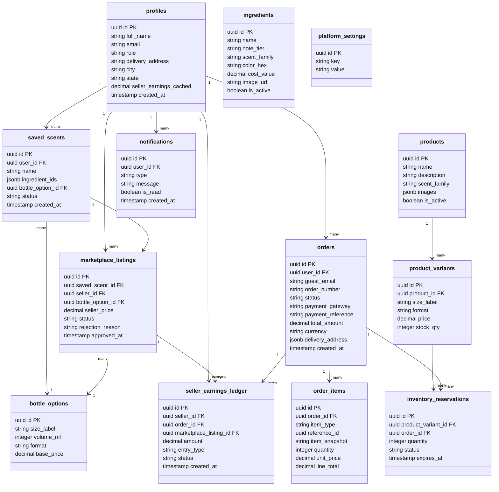
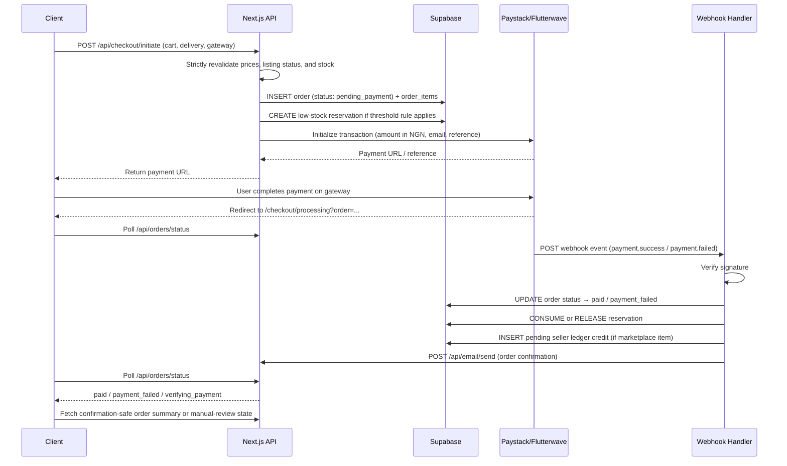

# Tech Plan — Build a Scent

## 1. Architectural Approach

### Core Stack

| Layer | Technology | Rationale |
| --- | --- | --- |
| Framework | Next.js 14+ (App Router) | Server Components for SEO-critical pages (shop, marketplace); Client Components for interactive mixer |
| Database & Auth | Supabase (PostgreSQL + Auth) | Single platform for DB, auth, storage, and real-time; Row Level Security enforces data access rules |
| Styling | Tailwind CSS + Framer Motion | Tailwind for layout/utility; Framer Motion for the mixer's liquid animations and transitions |
| Drag & Drop | `@dnd-kit/core` | Accessible, performant drag-and-drop; works well with React state for the mixer wizard |
| Payments | Paystack SDK + Flutterwave SDK | Both integrated as server-side Route Handlers; webhooks confirm payment server-side |
| Email | Nodemailer via Next.js API Routes | Simple SMTP-based transactional email; no external service dependency |
| Image/Asset Storage | Supabase Storage | Ingredient images, product images, bottle visuals |

### Key Architectural Decisions

**1. App Router with mixed rendering**

- Marketing pages (homepage, shop, marketplace listing pages) → Server Components with `fetch` for SEO and performance.
- Interactive surfaces (mixer, cart, library) → Client Components with React state.
- Admin panel → Server Components for data tables, Client Components for forms.

**2. Route group structure**

- `(public)` — homepage, shop, marketplace, product detail pages
- `(auth)` — sign in, sign up, account pages
- `(user)` — library, account dashboard (requires auth middleware)
- `(admin)` — `/admin/*` (requires admin role middleware)
- `api/` — Route Handlers for checkout initiation, payment status polling, webhooks, email, listing moderation, and guest order lookup

**3. Client-side cart for v1**
Cart state for both guests and logged-in users lives in a Zustand store persisted to localStorage/cookies. In v1, carts are not stored in Supabase and do not sync across devices. This keeps the architecture simple while preserving the required guest checkout flow; only orders are persisted server-side.

**4. Payment verification via webhook + processing page**
Both Paystack and Flutterwave send webhook events to `/api/webhooks/paystack` and `/api/webhooks/flutterwave`. Order status is updated **only** via webhook — never via the redirect URL alone. After gateway return, users land on a **Payment Processing** page that polls order status until the webhook confirms success or failure. Orders are created in `pending_payment` status, move to `verifying_payment` on redirect return, and only transition to `paid` after verified webhook receipt. If webhook confirmation does not arrive within the polling window, the order remains in `verifying_payment`, the user sees a manual-review message, and admin handles the case from the orders queue.

**5. Pricing formula**
Custom scent price = `bottle_option.base_price` + `SUM(ingredient.cost_value)`. `bottle_options` represents a fixed size + format combination, so pricing is attached to the chosen option rather than split between separate size and format fields. All cost values are admin-configured. The authoritative formula runs server-side at checkout initiation after strict revalidation and is stored on the order line item — not recalculated at payment time.

**6. Guest order access**
Guest orders are not directly readable from the database. During the active checkout flow, the app uses a short-lived checkout context to poll status and render confirmation safely. For later access, guests can look up an order through a server-side flow using **order number + email**.

**7. Marketplace listing bottle option**
A marketplace listing inherits the saved scent's default bottle option and cannot define separate size/format variants in v1. Each listing therefore represents a single purchasable SKU with one bottle option and one seller price. If a user initiates listing from the mixer, the platform requires auth if needed, saves the scent first, and then creates the listing from that saved scent record.

**8. Seller earnings ledger**
Marketplace earnings are recorded in an immutable ledger table. Seller earnings are created in a `pending` state after successful payment and only become `available` when the related order is marked fulfilled. The seller balance shown in the UI is a cached total on `profiles`, updated from ledger entries after availability changes. This supports retries, refunds, auditing, and future payouts more safely than a single mutable balance field alone.

**9. Currency handling**
NGN is the only checkout currency in v1. USD is display-only for browsing and comparison, and does not change stored order amounts or gateway settlement currency.

**10. Strict checkout revalidation**
Because carts are client-side in v1, `/api/checkout/initiate` revalidates every line item against live server data before payment starts. Custom scent prices are recalculated, marketplace listings must still be approved and purchasable, and standard product variants must still be available. If anything has changed, checkout is blocked and the client is forced back to cart review with the updated state.

**11. Low-stock reservation strategy**
Standard product variants use a hybrid stock strategy. If stock is at or below the admin-configured `low_stock_reserve_threshold`, checkout creates a temporary reservation before redirecting to payment. Otherwise stock is deducted only after payment succeeds. This limits oversell risk where it matters most without forcing full reservation complexity onto every product.

**12. Commission applied at sale time**
Marketplace listings store the seller's asking price, but the platform commission percentage is read from current platform settings at the moment of sale. Listing-time commission displays are informational only; the authoritative platform fee and seller earning split are captured on the order snapshot and seller ledger when payment succeeds.

**13. Admin role enforcement**
Supabase Auth custom claims store a `role` field (`user` | `admin`). Next.js middleware reads the JWT on every `/admin/*` request and redirects non-admins. Supabase RLS policies provide a second layer of enforcement at the database level.

## 2. Data Model

### Entity Relationship Overview



### Key Schema Notes

**`saved_scents.ingredient_ids`** — stored as a JSONB array of objects: `[{ id, note_tier, quantity }]`. This captures the exact blend formula without a separate junction table, keeping reads simple.

**`saved_scents.bottle_option_id`** — stores the default size/format combination chosen when the scent is saved. Reorder and marketplace listing flows use this as the scent's default purchasable configuration.

**`saved_scents.status`** — values: `draft` | `saved` | `listed`. A scent moves from `saved` → `listed` when a marketplace listing is created for it.

**Saved scents with inactive ingredients** — if any referenced ingredient is deactivated, the scent remains visible in the library but becomes fully view-only. Edit, reorder, and marketplace listing actions are disabled by server validation and reflected in the UI.

**`marketplace_listings.bottle_option_id`** — copied from the saved scent at listing time. In v1 a listing is a single fixed SKU, so buyers cannot switch size/format on the listing detail page.

**Marketplace commission timing** — listing records store seller price only. Platform commission is read from current settings at sale time and the actual fee split is preserved in the order snapshot and ledger entries.

**`orders.order_number`** — human-friendly lookup identifier used with `guest_email` for guest order lookup via a server-side endpoint.

**`orders.status`** — values include `pending_payment`, `verifying_payment`, `paid`, `payment_failed`, `cancelled`, `fulfillment_pending`, and `fulfilled`. If webhook confirmation never arrives, the order can remain in `verifying_payment` until admin review resolves it.

**`inventory_reservations`** — temporary holds for low-stock standard product variants. Reservation rows are created at checkout initiation when stock is at or below the configured threshold, then released on payment failure/expiry or consumed on successful payment.

**`order_items.item_type`** — values: `custom_scent` | `standard_product` | `marketplace_listing`. The `reference_id` points to the relevant entity. `item_snapshot` stores a JSON snapshot of the item at purchase time (name, notes, size, format, price, commission split) so order history is immutable even if the source entity changes.

**`seller_earnings_ledger`** — immutable entries such as `sale_credit`, `refund_debit`, and future `payout_debit`. Entries move through states such as `pending` and `available`. `profiles.seller_earnings_cached` is a derived/cached available balance used for fast reads in dashboards.

**`order_items`**** for marketplace purchases** — when `item_type = marketplace_listing`, post-payment processing creates a pending seller ledger credit. The credit becomes available only when the order is fulfilled.

**`platform_settings`** — a simple key-value table. Keys include the platform commission percentage, the display-only USD exchange rate, and the `low_stock_reserve_threshold` used to decide when temporary stock reservations are required.

**`bottle_options`** — fixed size + format combinations used by saved scents and marketplace listings. Admin manages all bottle options in one place.

## 3. Component Architecture

### Page & Component Map

```mermaid
graph TD
    A[Next.js App] --> B[Public Pages]
    A --> C[User Pages]
    A --> D[Admin Pages]
    A --> E[API Route Handlers]

    B --> B1[HomePage - Server]
    B --> B2[ShopPage - Server]
    B --> B3[ProductDetailPage - Server]
    B --> B4[MarketplacePage - Server]
    B --> B5[ListingDetailPage - Server]
    B --> B6[MixerPage - Client]
    B --> B7[CartPage - Client]
    B --> B8[CheckoutPage - Client]
    B --> B9[PaymentProcessingPage - Client]
    B --> B10[OrderConfirmationPage - Server]
    B --> B11[GuestOrderLookupPage - Client]

    C --> C1[LibraryPage - Client]
    C --> C2[AccountPage - Client]
    C --> C3[SellerDashboardPage - Client]

    D --> D1[AdminDashboard - Server]
    D --> D2[IngredientsManager - Client]
    D --> D3[ProductsManager - Client]
    D --> D4[ListingsQueue - Client]
    D --> D5[OrdersManager - Server]
    D --> D6[AnalyticsDashboard - Server]
    D --> D7[SettingsPage - Client]

    E --> E1[/api/checkout/initiate]
    E --> E2[/api/orders/status]
    E --> E3[/api/orders/lookup]
    E --> E4[/api/webhooks/paystack]
    E --> E5[/api/webhooks/flutterwave]
    E --> E6[/api/email/send]
    E --> E7[/api/listings/approve]
    E --> E8[/api/listings/reject]
```

### Component Responsibilities

#### Mixer System (Client)

- **`MixerWizard`** — top-level orchestrator; owns the 4-step state machine (`base | heart | top | preview`). Holds the in-progress blend in React state.
- **`IngredientGrid`** — renders ingredient cards for the current step tier; filtered by `note_tier` from Supabase.
- **`IngredientCard`** — draggable card with colour swatch, name, scent family tag. Uses `@dnd-kit` draggable.
- **`BottleDropZone`** — droppable target; accepts up to 3 ingredients per tier. Triggers the liquid fill animation on drop.
- **`BottleVisual`** — animated SVG/canvas bottle that renders three colour layers (base, heart, top) using Framer Motion. Layers animate in as ingredients are added.
- **`MixerPreview`** — Step 4 screen; shows completed bottle, name input, size/format selector, dynamic price display, and action buttons (Add to Cart / Save Draft / Save to Library / List for Sale).
- **`PriceCalculator`** — pure utility; computes `bottle_option.base_price + ingredient_costs` client-side for instant feedback. Final price is re-validated server-side at checkout initiation.

#### Cart & Checkout System

- **`CartStore`** — Zustand store persisted to localStorage/cookies. Holds items for both guests and logged-in users in v1. Exposes `addItem`, `removeItem`, `updateQty`, and `clearCart`. Cart state is intentionally device-local for simplicity.
- **`CartDrawer`** — slide-in panel accessible from the nav cart icon. Shows items, quantities, totals, currency toggle (NGN/USD display-only).
- **`CheckoutForm`** — collects delivery details; pre-fills from `profiles` for logged-in users.
- **`PaymentSelector`** — renders Paystack and Flutterwave radio options; on selection, calls `/api/checkout/initiate`, which strictly revalidates cart items against live data, creates the order in `pending_payment` status, optionally creates low-stock reservations, and returns the gateway payment URL/reference.
- **`PaymentProcessingPage`** — intermediate state shown after gateway return. Polls `/api/orders/status` and routes to final confirmation on `paid`, shows failure messaging on `payment_failed`, or falls back to an awaiting-manual-review message if verification times out while the order remains `verifying_payment`.
- **`GuestOrderLookupForm`** — public form that accepts `order_number + email` and calls `/api/orders/lookup`. This is the supported v1 mechanism for guests to retrieve prior orders.

#### Auth & Session

- **`AuthModal`** — the guest auth gate modal. Triggered by save and listing actions. Contains sign-up and sign-in tabs. On success, fires the pending action (save draft, save scent, save-then-list, etc.).
- **`AuthProvider`** — wraps the app; exposes Supabase session via React context. Middleware reads the JWT for route protection.

#### Library & Saved Scent System

- **`LibraryPage`** — renders two sections/tabs: **Saved Scents** and **Drafts**.
- **`SavedScentCard`** — shows finished scents with actions for edit, reorder, and list-for-sale when the scent is valid.
- **`DraftCard`** — shows draft scents with a **Resume** action that restores the saved draft state in the mixer.
- **`SavedScentAvailabilityGuard`** — evaluates whether referenced ingredients are still active. If not, the scent becomes fully view-only and the edit, reorder, and marketplace actions are disabled.

#### Marketplace

- **`ListingForm`** — pre-filled from the saved scent; collects seller price and description. Shows a live commission estimate based on the current platform rate and displays the inherited bottle option as read-only in v1. Submits to Supabase, sets listing status to `pending_review`.
- **`ListingIntentHandler`** — if listing starts from the mixer, requires auth if needed, saves the scent first, then routes into the listing form using the new saved scent record.
- **`ListingCard`** — used on the marketplace browse page; shows bottle visual, scent name, creator, price.
- **`SellerDashboard`** — shows the user's listings with status badges (`pending_review` | `approved` | `rejected`), rejection reasons, resubmit button, and accumulated earnings from the ledger-backed cached available balance.

#### Admin Panel

- **`AdminMiddleware`** — Next.js middleware that reads the Supabase JWT, checks `role === 'admin'`, redirects to `/` if not.
- **`ListingsQueue`** — paginated table of pending listings. Each row has Approve / Reject actions. Reject opens an inline reason input. On action, calls `/api/listings/approve` or `/api/listings/reject`, which updates the DB and triggers the email notification via `/api/email/send`.
- **`IngredientsManager`** — CRUD table for ingredients. Admin sets name, tier, scent family, colour hex, cost value, image upload (to Supabase Storage), and active status.
- **`OrdersManager`** — includes queues for fulfillment work and exceptional payment cases such as long-running `verifying_payment` orders that require manual review.
- **`AnalyticsDashboard`** — server-rendered aggregations: total revenue, orders by type (custom / standard / marketplace), top ingredients by selection count, top-selling marketplace scents, seller earnings summary.
- **`SettingsPage`** — manages platform commission, display-only currency settings, and the admin-defined `low_stock_reserve_threshold`.

### Data Flow — Payment (End-to-End)



### Supabase RLS Policy Summary

| Table | Policy |
| --- | --- |
| `saved_scents` | Users can only read/write their own rows. Admins can read all. |
| `marketplace_listings` | Public can read `approved` listings. Sellers can read/update their own. Admins can update all. |
| `orders` | Users can read their own orders. Admins can read all. Guests have no direct table access; public order status and lookup go through server-side endpoints using checkout context or `order_number + email`. |
| `profiles` | Users can read/update their own profile. Admins can read all. |
| `ingredients` | Public read (active only). Admin write. |
| `products` / `product_variants` | Public read (active only). Admin write. |
| `inventory_reservations` | Service role / server-side write. Admin read for operational review. No public direct access. |
| `platform_settings` | Admin read/write only. |
| `notifications` | Users can read/update their own notifications. |