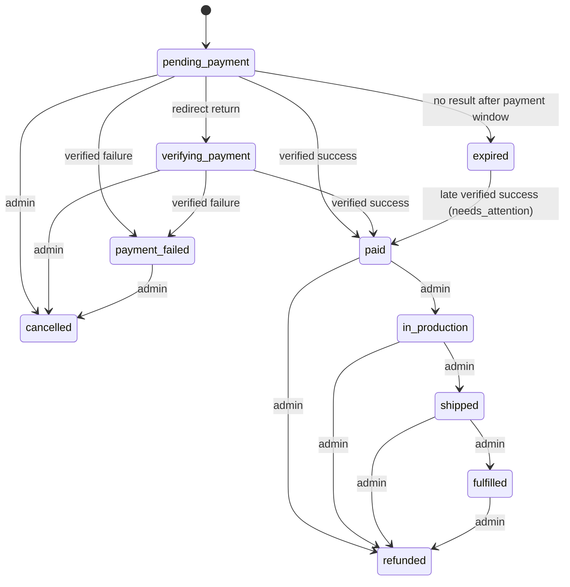
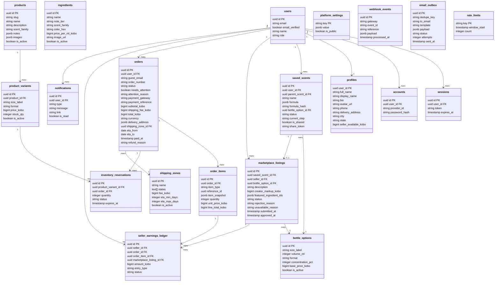

# Tech Plan — Build a Scent

## 1. Architectural Approach

### Core Stack

| Layer | Technology | Rationale |
| --- | --- | --- |
| Framework | Next.js 15+ (App Router), TypeScript | Server Components for SEO-critical pages (shop, marketplace); Client Components for interactive mixer |
| Hosting | Railway (Next.js app service + Postgres + cron service) | App and database share Railway's private network; a long-running Node server allows a normal connection pool and background jobs |
| Database | PostgreSQL on Railway | Single relational store for all app data; daily backups enabled on the Railway Postgres service |
| ORM & Migrations | Drizzle ORM + drizzle-kit (`node-postgres` driver) | SQL-first, typed schema, versioned migration files committed to the repo |
| Auth | Better Auth (email/password + Google OAuth, database sessions) | Self-hosted auth that stores users and sessions in our own Postgres; no third-party auth platform |
| Authorization | Server-side data access layer (DAL) | Replaces Supabase RLS: the browser never talks to the database; every read/write goes through server modules that enforce the access rules in §3 |
| Styling | Tailwind CSS + Framer Motion | Tailwind for layout/utility; Framer Motion for the mixer's liquid animations and transitions |
| Drag & Drop | `@dnd-kit/core` | Accessible, performant drag-and-drop; works well with React state for the mixer wizard |
| Payments | Paystack + Flutterwave REST APIs | Server-side Route Handlers; webhooks plus server-to-server verification confirm payment |
| Email | Nodemailer (SMTP) via a server-only module + `email_outbox` table | Simple SMTP; the outbox gives deduplication and retries |
| Image/Asset Storage | S3-compatible object storage (Railway Storage Bucket, or Cloudflare R2 if Buckets are unavailable on the plan) | Railway Postgres can't hold files and app containers have ephemeral disk; admin uploads go direct to the bucket via presigned URLs |
| Background jobs | Railway cron service running `pnpm jobs:run` every 5 minutes | Reservation expiry, stuck-payment re-verification, email retries |
| Money | Integer minor units (kobo) stored as `bigint` | Paystack/Flutterwave work in minor units; no floating-point rounding errors |

### Key Architectural Decisions

**1. App Router with mixed rendering**

- Marketing pages (homepage, shop, marketplace listing pages) → Server Components that query through the DAL for SEO and performance.
- Interactive surfaces (mixer, cart, library) → Client Components with React state, calling Server Actions / Route Handlers.
- Admin panel → Server Components for data tables, Client Components for forms.

**2. Route group structure**

- `(public)` — homepage, shop, marketplace, product detail pages, shared scent pages (`/s/[token]`)
- `(auth)` — sign in, sign up, password reset, account pages
- `(user)` — library, account dashboard, seller dashboard (requires a session)
- `(admin)` — `/admin/*` (requires `role = 'admin'`)
- `api/` — Route Handlers for Better Auth (`/api/auth/*`), checkout initiation, payment status polling, webhooks, guest order lookup, upload presigning

Listing moderation, settings and other admin mutations are Server Actions that call `requireAdmin()`; they do not need public API routes.

**3. Client-side cart for v1**
Cart state for both guests and logged-in users lives in a Zustand store persisted to localStorage. In v1, carts are not stored in Postgres and do not sync across devices. Only orders are persisted server-side. The store is built with the global shell (T10) so the mixer, library and shop can all add items.

**4. Database access and authorization (replaces Supabase RLS)**

- Postgres is reachable only from the app and cron services over Railway's private network (`DATABASE_URL` uses the internal hostname). No client-side database SDK exists.
- All queries live in `src/server/**` modules marked `server-only`. Each exported function takes the current session (or `null` for guests) and enforces the rules in the Authorization table (§3).
- Public reads return explicit column selections (e.g. a creator's `display_name`, never their email or address).
- Every authorization rule has a unit or integration test against a real Postgres (testcontainers or a Railway dev database).

**5. Auth, sessions and admin role**

- Better Auth with the Drizzle adapter owns the `users`, `sessions`, `accounts` and `verifications` tables. Sessions are stored in the database and referenced by an httpOnly cookie.
- `users.role` (`user` | `admin`) is the **single source of truth** for roles. No JWT custom claim exists, so it can't drift: the role is read from the DB when the session is resolved.
- Next.js middleware (`proxy.ts` on Next.js 16) does a cheap check: if there's no session cookie, it redirects `(user)` and `(admin)` routes to sign-in. It doesn't query the database.
- The authoritative check is `requireUser()` / `requireAdmin()`, called in the `(user)` and `(admin)` layouts **and** in every Server Action and Route Handler that mutates data. A non-admin hitting `/admin/*` is redirected to `/`.
- Providers in v1: email/password (with email verification and password reset) and Google OAuth. Listing a scent for sale requires a verified email.
- Admin bootstrap: a one-time CLI script `pnpm admin:promote --email <email>` (run via `railway run`) promotes an existing user to admin.

**6. Payment verification: webhook + server-side verify + processing page**

- Orders are created in `pending_payment`. Order status changes only from **server-side, gateway-verified data**: either a signature-verified webhook, or a server-to-server call to the gateway's verify endpoint (Paystack `GET /transaction/verify/:reference`, Flutterwave `GET /transactions/verify_by_reference?tx_ref=`). The browser redirect alone never marks an order paid.
- Every verification checks that the gateway's amount and currency equal the order's `total_kobo` in NGN. A mismatch never marks an order paid. Instead it sets `needs_attention`.
- **Forward-only transitions.** Every status change is a guarded update, e.g. `UPDATE orders SET status='paid' … WHERE id=$1 AND status IN ('pending_payment','verifying_payment','expired')`. The redirect-return handler only moves `pending_payment → verifying_payment`, so a webhook that arrives before the redirect can never be moved backwards.
- After gateway return, users land on `/checkout/processing`, which polls `/api/orders/status`. If the order is still unconfirmed after ~20 seconds, the status endpoint may trigger one server-side verify call (throttled to one per order every 30 seconds). If the order is still unconfirmed after ~90 seconds, the page stops spinning and shows the manual-review message.
- The cron job re-verifies orders stuck in `verifying_payment` for more than 10 minutes, every 5 minutes, for up to 24 hours. After that, only manual review remains. Admins can also trigger **"Re-verify with gateway"** from the order detail page.

**7. Pricing formula (custom scents)**

All prices are integer kobo. Each bottle option has a `volume_ml` and a `concentration_pct` (spray 20%, roll-on 25%, oil 100%; admin-configured). The fragrance concentrate is split across tiers by `tier_share_base` / `tier_share_heart` / `tier_share_top` (platform settings, default 40 / 35 / 25, must sum to 100). Within a tier, the concentrate is split equally among the selected ingredients.

```
concentrate_ml   = volume_ml × concentration_pct / 100
ingredient_cost  = Σ_tiers Σ_ingredients_in_tier  price_per_ml_kobo(i) × concentrate_ml × tier_share(t)/100 ÷ count(t)
blend_price      = bottle_option.base_price_kobo + ceil_to_naira(ingredient_cost)
```

`price_per_ml_kobo` and `base_price_kobo` are **retail** prices: they already include the platform's margin. Worked example (50ml spray, 20% → 10ml concentrate, base price ₦15,000):

| Tier (share) | Ingredients | ml each | Cost |
| --- | --- | --- | --- |
| Base (40% = 4ml) | Sandalwood ₦800/ml | 4 | ₦3,200 |
| Heart (35% = 3.5ml) | Rose ₦1,200/ml, Jasmine ₦1,000/ml | 1.75 | ₦2,100 + ₦1,750 |
| Top (25% = 2.5ml) | Bergamot ₦400/ml | 2.5 | ₦1,000 |
| | | **Blend price** | ₦15,000 + ₦8,050 = **₦23,050** |

The formula lives in one pure module, `src/lib/pricing.ts`, shared by the client (instant feedback) and the server (authoritative), with unit tests. It is recalculated server-side at checkout initiation and stored on the order item; it is not recalculated at payment time. No per-ingredient quantity exists in v1: proportions come entirely from the tier shares.

**8. Marketplace economics: creator markup on top of the blend price**

- A seller doesn't set a free-form price. They set a **creator markup** (≥ `min_creator_markup_kobo`, default ₦1,000) that sits on top of the live blend price of their formula + bottle option.
- `buyer_price = blend_price (live) + creator_markup`
- `platform_fee = blend_price + creator_markup × commission_pct / 100`
- `seller_earning = creator_markup × (1 − commission_pct / 100)`
- Every marketplace sale therefore earns the platform at least as much as the same blend ordered as a custom scent, so a listing can never sell below production cost. The commission applies to the markup only. If the admin changes ingredient or bottle prices, the buyer price moves with them while the seller's markup (and earnings) stay fixed.
- `commission_pct` is read from platform settings **at sale time**. Listing-time displays are estimates. The actual split is captured in the order item snapshot and the ledger at payment.

**9. Recipe protection on the marketplace**

- Buyer-facing marketplace surfaces (cards, listing detail, cart, checkout, confirmation, guest lookup, emails) show a **note profile**, not the formula: the scent family of each tier plus up to 3 **featured notes** the seller chooses to reveal. The full ingredient list is visible only to the seller and admins.
- `order_items.item_snapshot` still stores the full formula, for fulfilment. Buyer-facing renderers use a redacting serializer for marketplace items.
- **Duplicate formula guard.** `saved_scents.formula_hash` is a SHA-256 of the canonical formula: ingredient IDs sorted per tier, without the bottle option. A listing submission is blocked if another seller already has a `pending_review`, `approved` or `unavailable` listing with the same hash. Admins also see a duplicate warning in the review queue.
- Accepted residual risk: a determined user could still guess a blend from the featured notes and families, since v1 has only 1–3 ingredients per tier.

**10. Guest order access**
Guest orders are never readable without proof of ownership. Checkout initiation sets a short-lived **checkout context**: an HMAC-signed, httpOnly cookie holding `{order_id, exp}` and valid for 2 hours. The processing and confirmation pages use it. For later access, guests use `/orders/lookup` with **order number + email**, which is rate-limited. The confirmation page is a Server Component that reads the checkout context or the logged-in session and renders a confirmation-safe (redacted) summary.

**11. Marketplace listing bottle option**
A listing inherits the saved scent's bottle option and cannot define separate size/format variants in v1. Each listing is a single purchasable SKU. If a user starts listing from the mixer, the platform requires auth if needed, saves the scent first, and then creates the listing from that saved scent.

**12. Listed formulas are locked**
A saved scent's formula is immutable once saved. "Edit" always creates a new `saved_scents` row (`parent_scent_id` points to the original). While a scent has a listing in any state other than `withdrawn`, the seller can change only the listing's description, markup and featured notes, never the formula. A different formula is a new scent and a new listing.

**13. Seller earnings ledger**
Earnings are recorded in `seller_earnings_ledger`, one `sale_credit` per marketplace order item, created as `pending` when payment is verified. It becomes `available` when the order is marked `fulfilled`. On a refund, a `pending` credit is set to `void`. An `available` credit gets a matching negative `refund_debit` entry, so the seller balance can go negative and is netted against future earnings. `profiles.seller_available_kobo` is a cached sum of `available` entries, recomputed inside the same transaction as any ledger change. A unique constraint on `(order_item_id, entry_type)` prevents duplicates.

**14. Currency handling**
NGN is the only checkout currency in v1. USD is display-only (`kobo / 100 / usd_exchange_rate`). It never changes stored order amounts or the gateway settlement currency.

**15. Strict checkout revalidation**
Because carts are client-side, `/api/checkout/initiate` revalidates every line item against live data before payment starts:

- Custom scents: every ingredient is active and in the correct tier, the bottle option is active, the 1–3 per tier rule holds, and the price is recalculated.
- Marketplace listings: the listing is `approved`, every formula ingredient is active, and the buyer price is recalculated.
- Standard products: the product and variant are active, and stock is sufficient.
- Shipping: the delivery state belongs to an active shipping zone, and the fee is recalculated.

If anything changed, no order is created and the client is sent back to cart review with the updated state and a per-item explanation.

**16. Low-stock reservation strategy**
Standard product variants use a hybrid stock strategy. If available stock (`stock_qty` minus active reservations) is at or below `low_stock_reserve_threshold`, checkout creates a reservation that expires after `reservation_ttl_minutes` (default 30). Otherwise stock is deducted only after payment succeeds, with a guarded `UPDATE … WHERE stock_qty >= qty`. If a verified payment arrives after its reservation expired and stock is no longer available, the order is still marked `paid`, and `needs_attention` is set so an admin can refund or restock.

**17. Shipping**
v1 ships within Nigeria only. Admin-managed `shipping_zones` map Nigerian states to a flat per-order fee and a delivery ETA range. Checkout picks the zone from the delivery state, adds the fee to the order, and shows an estimated delivery window of production lead time (`production_lead_days`) plus the zone ETA. States that belong to no active zone can't check out.

**18. Email delivery**
Emails are sent by a server-only module (`src/server/email`), never through a public HTTP route. Every send first inserts an `email_outbox` row with a unique `dedupe_key` (e.g. `order_paid:<order_id>`) and is then delivered immediately. The cron job retries failed rows with backoff. A duplicate webhook therefore can't send a duplicate email.

**19. Order lifecycle and refunds**



In v1, refunds are **full refunds only**. The admin issues the refund in the gateway dashboard and then records it in the admin panel with a reason. Recording a refund in one transaction:

- sets the order to `refunded`;
- voids or debits the seller ledger entries;
- optionally returns standard-product stock;
- queues a refund email to the buyer.

Partial refunds and in-app gateway refund API calls are out of scope.

## 2. Data Model

All money columns are `bigint` kobo. All tables have `created_at` / `updated_at` (`timestamptz`). IDs are `uuid` (generated with `gen_random_uuid()`).

### Entity Relationship Overview



### Key Schema Notes

**`users` / `sessions` / `accounts` / `verifications`.** These are owned by Better Auth. `users.role` is added through Better Auth `additionalFields`, defaults to `user`, and can't be set from sign-up input.

**`profiles`.** One row per user, created in the same transaction as sign-up via a Better Auth `databaseHooks.user.create.after` hook. `display_name` is the only identity field shown publicly (marketplace creator name). `full_name`, phone and address are private.

**`saved_scents.formula`.** JSONB array `[{ ingredient_id, tier }]`, with 1–3 entries per tier for `saved` scents. Drafts may be partial (0–3 per tier). It is validated in the DAL with a Zod schema.

**`saved_scents.formula_hash`.** SHA-256 of the canonical formula (see Decision 9). It is indexed and computed only for complete formulas.

**`saved_scents.status`.** `draft` | `saved`. Listing state is **not** duplicated here. The library derives a "Listed" badge from the related `marketplace_listings` row. A unique index on `marketplace_listings.saved_scent_id` keeps the relationship one-to-one.

**`saved_scents.current_step`.** `base` | `heart` | `top` | `preview`, used by drafts so **Resume** returns the user to the step where they left off. `bottle_option_id` and `name` are nullable for drafts.

**`saved_scents.is_shared` / `share_token`.** These are used for opt-in public share links (`/s/[share_token]`). The token is random (≥128 bits) and can be revoked by turning sharing off.

**Saved scents with inactive ingredients or bottle options.** The scent stays visible in the library but becomes fully view-only. Edit, Reorder and List for Sale are disabled by server validation and reflected in the UI.

**`marketplace_listings.status`.** The values are:

- `pending_review` → `approved` or `rejected` (admin);
- `rejected` → `pending_review` (seller resubmits);
- `approved`, `pending_review` or `rejected` → `withdrawn` (seller);
- `withdrawn` → `pending_review` (seller relists);
- `approved` → `unavailable` (automatic, when an ingredient or the bottle option is deactivated) → `approved` (automatic, when everything is active again).

`unavailable` listings are hidden from the marketplace and fail checkout revalidation, and the seller is notified both when a listing becomes unavailable and when it comes back.

**`marketplace_listings.featured_ingredient_ids`.** Up to 3 ingredient IDs from the formula that the seller reveals to buyers.

**`marketplace_listings.bottle_option_id`.** Copied from the saved scent at listing time. In v1 a listing is a single fixed SKU.

**`products.slug`.** Unique, used by `/shop/[slug]`. `products.notes` is `{ base: string[], heart: string[], top: string[] }`, free text for pre-made products.

**`orders.order_number`.** Human-friendly, unique, non-sequential (e.g. `BAS-7K3M9Q`). It is used with `guest_email` for guest lookup.

**`orders.status`.** One of `pending_payment`, `verifying_payment`, `payment_failed`, `expired`, `paid`, `in_production`, `shipped`, `fulfilled`, `cancelled`, `refunded`. Transitions follow the diagram in Decision 19 and are enforced by guarded updates. `needs_attention` + `attention_reason` flag exceptional cases (amount mismatch, late payment after reservation expiry, stock conflict) for the admin queue.

**`inventory_reservations.status`.** `active` | `consumed` | `released`. Reservations are released on payment failure, expiry or cancellation, and consumed on verified payment.

**`order_items.item_type`.** `custom_scent` | `standard_product` | `marketplace_listing`. `reference_id` points to the bottle option / variant / listing. `item_snapshot` (JSONB) stores name, full formula with ingredient names and colours, bottle option, price breakdown and (for marketplace items) `blend_price_kobo`, `creator_markup_kobo`, `commission_pct`, `platform_fee_kobo`, `seller_earning_kobo`. Order history therefore stays unchanged even if the source changes. Buyer-facing reads of marketplace items are redacted (Decision 9).

**`seller_earnings_ledger`.**

- `entry_type`: `sale_credit` | `refund_debit` | (future) `payout_debit`
- `status`: `pending` | `available` | `void`
- Unique `(order_item_id, entry_type)`
- `profiles.seller_available_kobo` is the cached sum of `available` amounts.

**`webhook_events`.** Unique `(gateway, event_id)`. A webhook first inserts its event and skips processing if the event already exists. This, combined with the guarded status updates and the unique ledger and outbox keys, makes webhook handling idempotent.

**`email_outbox`.** Unique `dedupe_key`; `status` is `pending` | `sent` | `failed`.

**`rate_limits`.** Fixed-window counters keyed by `<route>:<ip or identifier>`, updated with a single upsert. Old rows are pruned by cron.

**`platform_settings`.** Key/value store with an `is_public` flag. The keys are:

| Key | Default | Public |
| --- | --- | --- |
| `commission_pct` | 20 | yes |
| `usd_exchange_rate` | — | yes |
| `min_creator_markup_kobo` | 100000 | yes |
| `tier_share_base` | 40 | yes |
| `tier_share_heart` | 35 | yes |
| `tier_share_top` | 25 | yes |
| `production_lead_days` | 3 | yes |
| `low_stock_reserve_threshold` | 5 | no |
| `reservation_ttl_minutes` | 30 | no |
| `payment_window_minutes` | 60 | no |

Public keys are served by a cached server function, `getPublicSettings()`.

**`bottle_options`.** Fixed size + format combinations used by the mixer, saved scents and listings, with an `is_active` flag. Admins manage them in one place.

**`ingredients`.** Can be hard-deleted only if no saved scent or order item has ever referenced them; otherwise they can only be deactivated.

## 3. Component Architecture

### Page & Component Map

```mermaid
graph TD
    A[Next.js App on Railway] --> B[Public Pages]
    A --> C[User Pages]
    A --> D[Admin Pages]
    A --> E[API Route Handlers]
    A --> F[Cron Jobs]

    B --> B1[HomePage - Server]
    B --> B2[ShopPage - Server]
    B --> B3[ProductDetailPage - Server]
    B --> B4[MarketplacePage - Server]
    B --> B5[ListingDetailPage - Server]
    B --> B6[MixerPage - Client]
    B --> B7[CartPage - Client]
    B --> B8[CheckoutPage - Client]
    B --> B9[PaymentProcessingPage - Client]
    B --> B10[OrderConfirmationPage - Server]
    B --> B11[GuestOrderLookupPage - Client]
    B --> B12[SharedScentPage - Server]

    C --> C1[LibraryPage - Client]
    C --> C2[AccountPage - Client]
    C --> C3[SellerDashboardPage - Client]
    C --> C4[OrderHistoryPage - Server]

    D --> D1[AdminDashboard - Server]
    D --> D2[IngredientsManager - Client]
    D --> D3[ProductsManager - Client]
    D --> D4[ListingsQueue - Client]
    D --> D5[OrdersManager - Server]
    D --> D6[AnalyticsDashboard - Server]
    D --> D7[SettingsPage - Client]

    E --> E0[/api/auth/*]
    E --> E1[/api/checkout/initiate]
    E --> E2[/api/orders/status]
    E --> E3[/api/orders/lookup]
    E --> E4[/api/webhooks/paystack]
    E --> E5[/api/webhooks/flutterwave]
    E --> E6[/api/uploads/presign]

    F --> F1[expire reservations & stale orders]
    F --> F2[re-verify stuck payments]
    F --> F3[retry email outbox]
    F --> F4[prune rate_limits]
```

### Component Responsibilities

#### Mixer System (Client)

- **`MixerWizard`** — top-level orchestrator. It owns the 4-step state machine (`base | heart | top | preview`) and holds the in-progress blend in React state. It can be initialised from a draft, a saved scent (Edit) or a shared scent.
- **`IngredientGrid`** — renders ingredient cards for the current step's tier (active ingredients only, fetched server-side and passed as props).
- **`IngredientCard`** — draggable card with colour swatch, name and scent family tag. Uses an `@dnd-kit` draggable, and also supports click / keyboard selection for accessibility.
- **`BottleDropZone`** — droppable target that accepts up to 3 ingredients per tier and triggers the liquid fill animation on drop.
- **`BottleVisual`** — animated SVG bottle that renders three colour layers (base, heart, top) with Framer Motion. It is reused by library cards, listing cards and the confirmation page.
- **`SaveDraftButton`** — persistent in the wizard header from Step 1 once at least 1 ingredient is selected. Saves the partial blend and current step as a draft (auth gate for guests).
- **`MixerPreview`** — the Step 4 screen: completed bottle, name input, bottle option selector, dynamic price display, and action buttons (Add to Cart / Save to Library / List for Sale).
- **`pricing.ts`** — a pure module implementing Decision 7 (and the marketplace split from Decision 8), used on both client and server.

#### Cart & Checkout System

- **`CartStore`** — Zustand store persisted to localStorage (built in T10). It holds items for guests and logged-in users and exposes `addItem`, `removeItem`, `updateQty`, `replaceAll` and `clearCart`. Items carry only identifiers (formula + bottle option, listing ID, variant ID) and the last-seen price for display. The server is always authoritative.
- **`CartDrawer`** — slide-in panel opened from the nav cart icon. It shows items, quantities, totals and the currency toggle (NGN, with USD display-only).
- **`CheckoutForm`** — collects name, email, phone and delivery address (Nigerian state picker). It pre-fills from `profiles` for logged-in users and shows the shipping fee and ETA once a state is chosen.
- **`PaymentSelector`** — renders the Paystack and Flutterwave options. "Pay Now" calls `/api/checkout/initiate`, which revalidates the cart, creates the order (`pending_payment`) and items, creates any low-stock reservations, initialises the gateway transaction, sets the checkout context cookie and returns the payment URL.
- **`PaymentProcessingPage`** — shown after gateway return. It polls `/api/orders/status` and routes to confirmation on `paid` and to failure messaging on `payment_failed`. If the order is still `verifying_payment` after ~90 seconds, it shows the manual-review message.
- **`GuestOrderLookupForm`** — public form that takes `order_number + email` and calls `/api/orders/lookup` (rate-limited).

#### Auth & Session

- **`AuthModal`** — the guest auth gate modal, triggered by save and listing actions. It has sign-up and sign-in tabs plus Google sign-in. The pending action and the current mixer state are kept in `sessionStorage`, so they survive the OAuth redirect; after auth, the pending action runs (save draft, save scent, save-then-list).
- **`AuthProvider`** — client context exposing the Better Auth session (`useSession`).
- **`requireUser()` / `requireAdmin()`** — server guards used in layouts, Server Actions and Route Handlers.

#### Library & Saved Scent System

- **`LibraryPage`** — renders two tabs: **Saved Scents** and **Drafts**.
- **`SavedScentCard`** — shows finished scents with a "Listed" / listing-status badge and actions for Reorder, Edit, Share and List for Sale while the scent is valid.
- **`DraftCard`** — shows draft scents (partial notes, step reached) with **Resume** and **Delete** actions.
- **`SavedScentAvailabilityGuard`** — checks whether every ingredient and the bottle option are still active. If not, the scent becomes fully view-only.
- **`ShareControl`** — toggles `is_shared` and copies the `/s/[token]` link.
- **`SharedScentPage`** — public, read-only page with the bottle visual, name, creator display name and notes, plus "Order this blend" (adds it to the cart as a custom scent) and "Build your own". If the scent has an `approved` listing, the page hides the formula, shows the note profile and links to the listing instead.

#### Marketplace

- **`ListingForm`** — pre-filled from the saved scent. It collects description, creator markup and up to 3 featured notes. It shows a live breakdown (blend price, markup, buyer price, estimated earnings at the current commission rate) and the inherited bottle option as read-only. Submitting runs the duplicate-formula check and creates the listing with status `pending_review`. It requires a verified email.
- **`ListingIntentHandler`** — when listing starts from the mixer, it requires auth if needed, saves the scent first, then routes to the listing form for the new saved scent.
- **`ListingCard`** — used on the marketplace browse page. It shows the bottle visual, scent name, creator display name, note profile and buyer price.
- **`SellerDashboard`** — lists the seller's listings with status badges (`pending_review` | `approved` | `rejected` | `unavailable` | `withdrawn`), rejection or unavailability reasons, Edit & Resubmit, Withdraw / Relist, pending vs available earnings, and ledger history.

#### Admin Panel

- **`AdminLayout`** — sidebar shell for all admin pages (built in T10). Pages and actions call `requireAdmin()`.
- **`ListingsQueue`** — paginated pending listings with full formula, price breakdown and duplicate warning. Approve / Reject (inline reason input) are Server Actions that update the listing, create the notification and queue the email in one transaction.
- **`IngredientsManager`** — CRUD for ingredients (name, tier, scent family, colour hex, price per ml, image, active). Deactivation cascades: affected approved listings become `unavailable` and their sellers are notified. Reactivation reverses this.
- **`BottleOptionsManager`** — CRUD for bottle options (size, volume, format, concentration, base price, active).
- **`OrdersManager`** — all orders, with filters by status, type and `needs_attention`. It includes the manual-review queue (`verifying_payment` and `needs_attention`) with **Re-verify with gateway**, status transitions (in production → shipped → fulfilled), cancel and record refund. Marking an order `fulfilled` releases its pending seller credits.
- **`AnalyticsDashboard`** — server-rendered aggregations over paid-or-later orders: total revenue, orders by type (custom / standard / marketplace), top ingredients by selection count (from `item_snapshot` formulas of paid orders), top-selling marketplace scents, seller earnings summary (pending / available / total).
- **`SettingsPage`** — manages `platform_settings` (with validation, e.g. tier shares must sum to 100) and `shipping_zones`.

### Data Flow — Payment (End-to-End)

```mermaid
sequenceDiagram
    participant Client
    participant App as Next.js (Railway)
    participant DB as Postgres (Railway)
    participant Gateway as Paystack/Flutterwave

    Client->>App: POST /api/checkout/initiate (cart, delivery, gateway)
    App->>DB: Revalidate prices, listings, ingredients, stock, shipping zone
    App->>DB: BEGIN; INSERT order (pending_payment) + order_items; INSERT reservations if low stock; COMMIT
    App->>Gateway: Initialize transaction (total_kobo NGN, email, reference)
    Gateway-->>App: Payment URL
    App-->>Client: Payment URL + Set-Cookie checkout_context
    Client->>Gateway: User completes payment
    Gateway-->>Client: Redirect to /checkout/processing?order=...
    Client->>App: Return handler: pending_payment → verifying_payment (guarded)
    Gateway->>App: POST webhook (signed)
    App->>App: Verify signature; check amount & currency
    App->>DB: INSERT webhook_events (skip if duplicate)
    App->>DB: BEGIN; guarded UPDATE order → paid / payment_failed; consume/release reservations or deduct stock; INSERT pending sale_credit per marketplace item; INSERT email_outbox; COMMIT
    App->>App: Deliver queued email (SMTP)
    Client->>App: Poll /api/orders/status (may trigger throttled server-side verify)
    App-->>Client: paid / payment_failed / verifying_payment
    Client->>App: Confirmation page (redacted summary) or manual-review state
```

### Authorization Rules (enforced in the DAL)

| Data | Rule |
| --- | --- |
| `saved_scents` | The owner can read/write their own rows. Admins can read all. The public can read a scent only through a valid `share_token` while `is_shared = true` (formula hidden if the scent has an approved listing). |
| `marketplace_listings` | The public can read `approved` listings (note profile only, no formula). Sellers can read their own listings and update description, markup and featured notes in allowed states. Only admins can approve or reject. `unavailable` transitions are system-only. |
| `orders` / `order_items` | Users can read their own orders. Guests can read an order only with a valid checkout context or a matching `order_number + email`, and only as a confirmation-safe, redacted view. Admins can read and transition all orders. |
| `profiles` | Users can read and update their own profile. The public can read only `display_name`, `avatar_url` and `bio` for sellers with approved listings. Admins can read all. |
| `users.role` | Never user-writable. Changed only by the admin bootstrap script or by an admin. |
| `ingredients` / `bottle_options` | The public can read active rows. Only admins can write. |
| `products` / `product_variants` | The public can read active rows. Only admins can write. |
| `inventory_reservations` | Written only by the system (checkout, webhooks, cron). Admins can read. |
| `seller_earnings_ledger` | Sellers can read their own entries. Written only by the system and by admin fulfilment/refund actions. Admins can read all. |
| `platform_settings` | The public can read `is_public = true` keys via `getPublicSettings()`. Only admins can read or write the rest. |
| `shipping_zones` | The public can read active zones. Only admins can write. |
| `notifications` | Users can read and mark read their own. Created only by the system. |
| `webhook_events` / `email_outbox` / `rate_limits` | System only. Admins can read webhook events and the outbox for debugging. |

### Environment Variables

`DATABASE_URL`, `BETTER_AUTH_SECRET`, `BETTER_AUTH_URL`, `GOOGLE_CLIENT_ID`, `GOOGLE_CLIENT_SECRET`, `CHECKOUT_CONTEXT_SECRET`, `PAYSTACK_SECRET_KEY`, `FLUTTERWAVE_SECRET_KEY`, `FLUTTERWAVE_WEBHOOK_HASH`, `SMTP_HOST`, `SMTP_PORT`, `SMTP_USER`, `SMTP_PASS`, `EMAIL_FROM`, `S3_ENDPOINT`, `S3_BUCKET`, `S3_ACCESS_KEY_ID`, `S3_SECRET_ACCESS_KEY`, `S3_PUBLIC_BASE_URL`, `APP_URL`. These are validated at boot with Zod: the app refuses to start if a required variable is missing.
